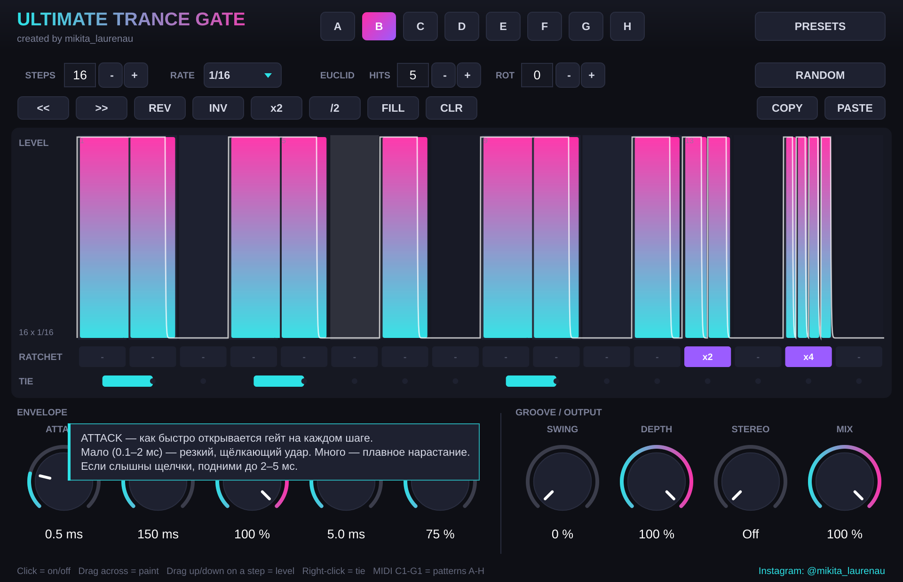

# Ultimate Trance Gate

**created by mikita_laurenau** · [Instagram](https://www.instagram.com/mikita_laurenau/)

Трансгейт-секвенсор в духе Kilohearts Trance Gate, только ритмов намного больше.
Формат: VST3 и AU для macOS (Apple Silicon и Intel), работает в Ableton Live 11.



## Что умеет

- **8 слотов паттернов (A–H).** Переключаются кнопками, автоматизацией параметра *Pattern* или MIDI-нотами C1–G1 (по хроматике: C1=A, C#1=B, D1=C … G1=H).
- **До 32 шагов** в каждом паттерне, у каждого слота своя длина и своя сетка: 1/4, 1/8, 1/8T, 1/8D, 1/16, 1/16T, 1/16D, 1/32, 1/32T, 1/64. Нечётная длина даёт полиметрию.
- **Каждый шаг:** громкость, **ratchet** (2, 3 или 4 повтора внутри шага, для рейджевых роллов и статтеров) и **tie** (легато в следующий шаг, без ретригера).
- **232 готовых ритма:** папка **Creative** (100 экспериментальных ритмов: нечётные длины, свеллы, глитчи, легато-формы) и жанры Trance, Psytrance / Goa, Eurodance, Hands Up / Dance 2000s, EDM / Big Room, Future Bass, Hardstyle, Rage, Trap / Drill / Plugg, House / Garage, Jersey Club, Techno, Breaks / DnB, плюс Euclidean / Poly и Stutter / FX. Полный список с паттернами: [docs/PRESETS.md](docs/PRESETS.md).
- **Генераторы:** евклидовы ритмы (HITS и ROT, применяются сразу), Random (Sparse / Medium / Dense / Rage с ратчетами / Mutate 25% / случайные акценты).
- **Инструменты:** сдвиг ◀▶, реверс, инверсия, x2 (дублировать), /2, Fill, Clear, Copy/Paste между слотами.
- **Огибающая:** Attack, Decay, Sustain, Release, Gate (сколько шаг остаётся открытым). Реальная форма огибающей рисуется поверх шагов.
- **Groove / Output:** Swing, Depth (насколько глубоко режет), **Stereo** (правый канал отстаёт на N шагов, получается пинг-понг гейт), Mix.
- **Подсказки:** если держать мышь над любой ручкой, кнопкой или рядом сетки 2 секунды, появится объяснение, что это и зачем нужно.
- Синхронизируется с темпом и позицией DAW. Когда транспорт остановлен, крутится сам по себе, так что паттерн можно слушать без запуска проекта.

## Управление сеткой

| Действие | Что делает |
|---|---|
| Клик по пустому шагу | включить (высота клика = громкость) |
| Клик по включённому шагу | выключить |
| Протянуть по шагам | рисовать / стирать |
| Тянуть вверх-вниз по включённому шагу (или Shift + перетаскивание) | громкость |
| Двойной клик | шаг на 100% |
| Правый клик по шагу или клик в ряду TIE | легато в следующий шаг |
| Клик в ряду RATCHET | 1 → x2 → x3 → x4 (правый клик = сброс) |

## Установка: вариант 1, собрать на своём Mac (≈10 минут)

1. Открой Терминал.
2. `xcode-select --install` (если уже стоит, просто напишет, что установлено).
3. Перейди в папку проекта и запусти скрипт:
   ```
   cd ~/Downloads/TranceGate
   bash build_mac.sh
   ```
   Скрипт сам поставит cmake, скачает JUCE, соберёт, подпишет и положит плагины в
   `~/Library/Audio/Plug-Ins/VST3` и `~/Library/Audio/Plug-Ins/Components`.
4. В Ableton: **Settings → Plug-ins → Use VST3 Plug-in System Folders: On → Rescan**.

## Установка: вариант 2, собрать в облаке через GitHub (без Xcode)

1. Создай репозиторий на GitHub и залей туда содержимое папки.
2. Вкладка **Actions** → workflow **Build macOS** запустится сам (или нажми *Run workflow*).
3. Скачай артефакт **UltimateTranceGate-macOS**, распакуй и дважды кликни `install_mac.command`
   (если macOS ругается, сделай правый клик → Открыть).

## Переключение паттернов MIDI-нотами в Ableton

1. Повесь Ultimate Trance Gate на аудиодорожку.
2. Создай MIDI-дорожку, в **MIDI To** выбери ту аудиодорожку, а ниже выбери **Ultimate Trance Gate**.
3. Ноты C1…G1 в клипе переключают слоты A…H.

Проще без MIDI: автоматизируй параметр **Pattern** прямо на дорожке.

## Как добавить свои ритмы в библиотеку

Файл `Source/Presets.h`, одна строка на ритм:
```
add (R, "My Rhythm", "X-.X -.X. X-.X 2.4.");   // R = категория Rage
```
`X`=100%, `x`=70%, `o`=40%, `,`=20%, `.`=пауза, `-`=легато, `2/3/4`=ratchet. Пробелы игнорируются.
Сетку можно указать последним аргументом: `R8T`, `R16T`, `R32` и т.д.

## Для разработчиков

- `Source/GateEngine.h`: DSP (позиция шага, свинг, ратчеты, ADSR).
- `Source/Pattern.h`: данные паттерна, генераторы, lock-free хранилище для аудиопотока.
- `Source/StepGrid.cpp`: редактор шагов. `Source/PluginEditor.cpp`: остальной UI.
- Офлайн-тест: `cmake -B build -DTG_BUILD_TESTS=ON && cmake --build build && ./build/UTGRenderTest_artefacts/Release/UTGRenderTest`

Построено на JUCE 8 (лицензия AGPLv3 / коммерческая; для личного использования бесплатно).
