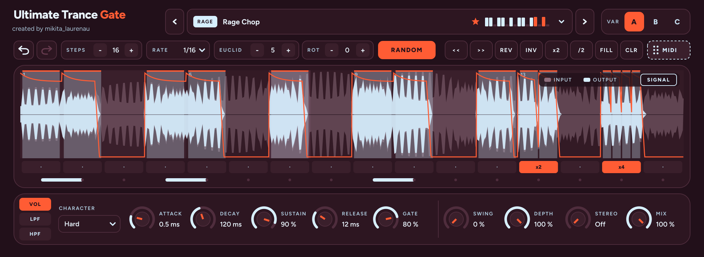
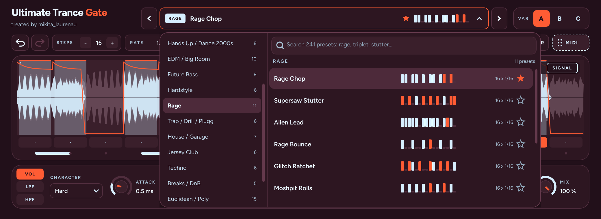
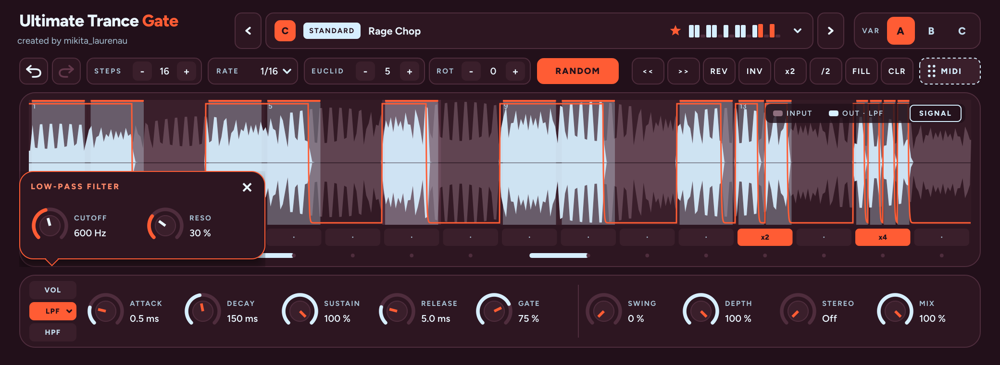

# Ultimate Trance Gate — руководство пользователя

created by mikita_laurenau · версия 2.0

## Что это

Ultimate Trance Gate режет звук по ритмическому паттерну в темпе проекта. Из длинного пэда, аккорда или лида получаются чопы, стабы и статтеры. Формат: VST3 и AU для macOS (Apple Silicon и Intel), VST3 для Windows. Проверен в Ableton Live 11.

Возможности:

- 240 готовых ритмов в 17 папках: Standard, жанры (Trance, Eurodance, Rage, EDM и другие), Euclidean / Poly, Stutter / FX и 100 экспериментальных в Creative. Есть поиск и избранное.
- Три вариации A / B / C. У каждой свой ритм и свои положения всех ручек; переключаются кликом или автоматизацией.
- До 32 шагов, сетка от 1/4 до 1/64, включая триоли и точки. На каждом шаге: громкость, ratchet (2–4 удара внутри шага) и tie (легато в следующий шаг).
- Три режима гейта: VOL (громкость), LPF и HPF (гейт управляет фильтром).
- Живая волна сигнала под шагами: видно, что пришло в плагин и что из него вышло.
- Undo / Redo, евклидов генератор, Random, инструменты для правки паттерна.
- Перетаскивание ритма в Ableton как MIDI-клипа.
- Подсказки: задержи мышь над любой ручкой или кнопкой на 2 секунды.
- Без задержки (латентность 0). Всё сохраняется вместе с проектом.

## Установка

Готовые сборки лежат на странице релизов: [github.com/Niklauren/Ultimate-Trance-Gate/releases](https://github.com/Niklauren/Ultimate-Trance-Gate/releases). Ссылку можно просто кидать друзьям, собирать ничего не нужно.

### Mac

1. Скачай UltimateTranceGate-2.0.0-Mac-Installer.pkg и закрой DAW.
2. Дважды кликни установщик → Продолжить → Установить, введи пароль Mac. VST3 и AU встанут в /Library/Audio/Plug-Ins. Кнопкой «Настроить» можно поставить только VST3 или только AU.
3. Если macOS не даёт открыть установщик: правый клик → Открыть. На macOS 15 и новее: Системные настройки → Конфиденциальность и безопасность → внизу «Всё равно открыть».
4. Открой Ableton и пересканируй плагины (см. ниже).

Если раньше плагин ставился через install_mac.command, установщик сам уберёт старую копию, чтобы в DAW не было двух одинаковых. Архив UltimateTranceGate-macOS.zip с install_mac.command остаётся для ручной установки.

### Windows

1. Скачай UltimateTranceGate-2.0.0-Windows-Setup.exe и закрой DAW.
2. Запусти → Далее → Установить. Плагин встанет в C:\Program Files\Common Files\VST3.
3. Если SmartScreen предупреждает: «Подробнее» → «Выполнить в любом случае».
4. Перезапусти DAW и пересканируй плагины. Удалить можно через «Параметры → Приложения».

### Подключение в Ableton Live 11

1. Settings → Plug-ins → включи Use VST3 Plug-in System Folders (для AU на Mac — Use Audio Units).
2. Нажми Rescan.
3. В браузере Plug-ins появится Ultimate Trance Gate от mikita_laurenau. Перетащи его на аудио- или инструментальную дорожку как обычный эффект.

## Обзор интерфейса

Окно делится на четыре зоны сверху вниз. Работа идёт в том же порядке: выбрал пресет, поправил ритм, настроил звучание ручками.

1. **Шапка.** Название и подпись created by mikita_laurenau (клик открывает Instagram). В центре строка пресета со стрелками ‹ ›, справа переключатель вариаций VAR A / B / C.
2. **Строка паттерна.** Undo и Redo, STEPS (длина), RATE (сетка), EUCLID (HITS и ROT), RANDOM, инструменты << >> REV INV x2 /2 FILL CLR и кнопка MIDI для перетаскивания.
3. **Сетка шагов.** Ряд LEVEL (столбики громкости), под ним ряды RATCHET и TIE. Оранжевая линия — громкость гейта с учётом огибающей. Под шагами волна сигнала. Подсвеченный столбец — шаг, который играет сейчас.
4. **Ручки.** Слева режим VOL / LPF / HPF, дальше ATTACK, DECAY, SUSTAIN, RELEASE, GATE, а после разделителя SWING, DEPTH, STEREO, MIX.

Ручки крутятся перетаскиванием вверх-вниз, по клику на число можно ввести значение с клавиатуры. Если держать мышь над любой ручкой, кнопкой или рядом сетки 2 секунды, появится подсказка: что это и зачем нужно.

## Пресеты

Клик по строке пресета открывает библиотеку. Слева папки, справа ритмы: у каждого видно рисунок шагов, длину и сетку. Клик по ритму загружает его в текущую вариацию и закрывает окно. Закрыть без выбора: клик мимо окна или Esc.

- **Поиск.** Поле сверху ищет сразу по всем папкам: по названию и по жанру (rage, triplet, stutter).
- **Избранное.** Звёздочка справа от ритма добавляет его в папку ★ Favorites. Избранное общее для всех проектов.
- **Стрелки ‹ ›** в шапке листают ритмы внутри текущей папки, удобно перебирать на ходу.
- **Звёздочка * после названия** значит, что ритм изменён после загрузки.
- Пресет меняет только ритм (шаги, длину, сетку). Ручки остаются как есть.

| Папка | Ритмов | Темп, BPM | Характер | С чего начать |
|---|---|---|---|---|
| Standard | 8 | любой | Восемь базовых ритмов A–H, грузятся и MIDI-нотами | Sunrise Gate, Rage Chop |
| Trance | 14 | 128–140 | Гейтованные пэды и аккорды, 16-е, галопы | Sunrise Gate, Gallop Gate, Build-Up 32 |
| Psytrance / Goa | 10 | 138–150 | Катящийся бас после бочки (KBBB), триоли | KBBB Roll, Goa Triplet Roll |
| Eurodance | 13 | 130–145 | Стабы на слабую долю, синкопа 3-3-2, пианино | Rhythm Stab 3-3-2, 90s Offbeat Stab |
| Hands Up / Dance 2000s | 8 | ~140 | Суперсо-лиды, сайдчейн-бас, джампстайл | Hands Up Lead, Supersaw Drive |
| EDM / Big Room | 10 | 126–130 | Донк-бас, фестивальные стабы, пампинг | Bounce Offbeat, Big Room Drop |
| Future Bass | 8 | 140–160 | Рубленые и нарастающие аккорды | 3-3-2 Chords, Swell Gate |
| Hardstyle | 6 | 150–160 | Reverse bass между бочками, скричи | Reverse Bass Swell, Euphoric Lead |
| Rage | 11 | 150–170 | Зацикленные суперсо-лиды, статтеры, роллы | Rage Chop, Supersaw Stutter, Alien Lead |
| Trap / Drill / Plugg | 6 | 130–160 | Баунс, тянущиеся 808, триоли | Plugg Bounce, 808 Glide |
| House / Garage | 7 | 120–138 | Аккорды на слабую долю, 2-step | 2-Step Stabs, Piano House |
| Jersey Club | 6 | 130–145 | Пятиударный клабный ритм, триольные сбивки | Jersey Kick, Jersey Bounce |
| Techno | 6 | 125–150 | Рамблы, офф-аккорды, эсид-акценты | Rumble, Off-Chord |
| Breaks / DnB | 5 | 160–175 | Ритмы брейков | Amen Gate, Two-Step DnB |
| Euclidean / Poly | 15 | любой | Евклидовы и полиметрические ритмы | Euclid 3/8 Tresillo, Poly 5 |
| Stutter / FX | 7 | любой | Статтеры, тейп-стоп, сбивки в конце такта | Machine Gun, Bar End Fill |
| Creative | 100 | любой | Нечётные длины, свеллы, глитчи, легато-фигуры, концепт-ритмы | Heartbeat, Glitch Cascade, Rage Waterfall |

Шаффл-жанры (гараж, джерси) записаны на триольной сетке 1/16T, свинг уже встроен. Ручку Swing для них оставляй на 0%. Полный список с рисунком каждого ритма — файл docs/PRESETS.md в репозитории.

### Standard и MIDI-ноты

Папка Standard — восемь стартовых ритмов: A Sunrise Gate, B Rhythm Stab 3-3-2, C Rage Chop, D Gallop Gate, E KBBB Roll, F Supersaw Stutter, G 3-3-2 Chords, H Build-Up 32. Их можно загружать MIDI-нотами прямо во время игры: C1 = A, C#1 = B, D1 = C, D#1 = D, E1 = E, F1 = F, F#1 = G, G1 = H. Нота загружает ритм в текущую вариацию.

Как подключить: создай MIDI-дорожку, в MIDI To выбери дорожку с плагином, во втором поле — Ultimate Trance Gate. Мониторинг в режиме Auto или In.

## Вариации A / B / C

Вариация — отдельная копия всей настройки: ритм, режим, все ручки, включая фильтр. Сделай на A куплетный ритм, на B — припев, на C — сбивку, и переключай.

- Переключение кликом по VAR A / B / C в шапке.
- Автоматизацией: параметр Variation. В Ableton выбери его в лане автоматизации и нарисуй ступеньки.
- Переключается сразу, без ожидания конца такта. Для чистого перехода ставь точку автоматизации на начало такта.
- При первом запуске: A — Rage Chop, B — Rhythm Stab 3-3-2, C — Supersaw Stutter.

Синхронизация: пока транспорт идёт, паттерн привязан к позиции в проекте и попадает в сетку при перемотке и лупе. Когда транспорт стоит, паттерн крутится сам в темпе проекта, удобно слушать с клавиатуры.

## Сетка шагов

Каждый столбец — один шаг. У шага три свойства: громкость (LEVEL), число ударов внутри шага (RATCHET) и связь со следующим шагом (TIE).

| Действие | Где | Что делает |
|---|---|---|
| Клик по пустому шагу | LEVEL | Включает шаг; высота клика задаёт громкость |
| Клик по включённому шагу | LEVEL | Выключает шаг |
| Протянуть по соседним шагам | LEVEL | Рисует (начал с пустого) или стирает (начал с включённого) |
| Тянуть вверх-вниз по включённому шагу | LEVEL | Меняет громкость шага |
| Shift (или Cmd, Alt) + перетаскивание | LEVEL | Сразу режим громкости, без включения/выключения |
| Двойной клик | LEVEL | Шаг на 100% |
| Правый клик по шагу | LEVEL | Включает или снимает tie |
| Клик | RATCHET | 1 → x2 → x3 → x4 → 1 |
| Правый клик | RATCHET | Сброс на 1 |
| Клик | TIE | Включает или снимает tie |

**Ratchet** дробит шаг на несколько быстрых ударов. На сетке 1/16 режим x2 даёт два удара по 1/32, x4 — четыре по 1/64. Так получаются роллы и статтеры. На сетке такой шаг рисуется несколькими узкими столбиками.

**Tie** склеивает шаг со следующим: гейт не закрывается, и следующий шаг не бьёт заново. Без tie «та-та-та-та», с tie на первом шаге «таа-та-та». Если у связанных шагов разная громкость, звук плавно перетекает на новый уровень.

### Волна сигнала

Под шагами в реальном времени рисуется звук, который проходит через плагин:

- **INPUT** (приглушённая волна сзади) — что пришло в плагин.
- **OUTPUT** (светлая волна спереди) — что вышло. Видимая часть INPUT над OUTPUT — то, что гейт срезал.

На открытых шагах волны совпадают, в паузах OUTPUT опускается настолько, насколько режет гейт. Поэтому видно, как на сигнал влияют Depth, Mix и огибающая. Кнопка SIGNAL справа над сеткой включает и выключает волну. Если звука нет (транспорт стоит, на дорожке тишина), волна не рисуется.

## Генераторы и инструменты

Всё действует на текущую вариацию. Любое действие можно отменить кнопкой Undo.

- **Undo / Redo** (стрелки слева) отменяют и возвращают правку шагов, загрузку пресета, движение ручки, смену режима и вариации. Горячие клавиши: Cmd+Z и Cmd+Shift+Z (на Windows Ctrl+Z и Ctrl+Shift+Z). Работают, когда окно плагина активно: сначала кликни в нём. Если клавиши перехватывает Ableton, жми кнопки.
- **EUCLID** раскладывает удары как можно равномернее. HITS — сколько ударов, ROT — сдвиг на N шагов. Паттерн меняется сразу. 3 удара на 8 шагов — тресилло (3-3-2), 5 на 16 — босса, 7 на 16 — самба.
- **MIDI** — потяни кнопку мышкой и брось на MIDI-дорожку Ableton. Получится клип с этим ритмом: нота C3, громкость ноты = сила шага, ратчеты и tie тоже переносятся. Удобно, чтобы хэты, бас или чопы играли в том же ритме.

RANDOM открывает меню:

| Пункт | Что делает |
|---|---|
| Sparse | Редкий случайный ритм, около 30% шагов |
| Medium | Около половины шагов |
| Dense | Плотный, около 80% шагов |
| Rage (ratchets + ties) | Случайный ритм с ратчетами, легато и тихими ударами |
| Mutate 25% | Меняет примерно четверть шагов текущего паттерна |
| Random accents | Оставляет ритм, но случайно меняет громкость шагов |

| Кнопка | Что делает |
|---|---|
| << / >> | Сдвигает паттерн на шаг влево или вправо по кругу |
| REV | Переворачивает паттерн задом наперёд |
| INV | Меняет местами включённые и выключенные шаги |
| x2 | Копирует паттерн во вторую половину и удваивает длину (до 32 шагов) |
| /2 | Оставляет первую половину |
| FILL | Включает все шаги на 100% |
| CLR | Очищает паттерн |

Длина и сетка: STEPS — от 1 до 32 шагов. RATE — длина шага: 1/4, 1/8, 1/8T, 1/8D, 1/16, 1/16T, 1/16D, 1/32, 1/32T, 1/64 (T — триоль, D — с точкой). Один такт — это 16 шагов по 1/16, 12 по 1/8T или 32 по 1/32. Длина, которая не делит такт (5 или 7 шагов), даёт полиметрию: ритм каждый такт сдвигается.

## Режимы VOL / LPF / HPF и фильтр

Режим выбирается кнопками слева в нижней панели.

- **VOL** — классический трансгейт: в паузах звук становится тише.
- **LPF** — гейт управляет фильтром низких частот: в паузах звук становится тёмным и глухим, а не тихим.
- **HPF** — гейт управляет фильтром высоких частот: в паузах уходит низ, звук становится тонким.

При выборе LPF или HPF над кнопками выезжает панель фильтра с двумя ручками:

- **CUTOFF** (20 Гц–20 кГц, по умолчанию 600 Гц) — частота фильтра на закрытых шагах. На открытых шагах фильтр полностью открыт. В LPF чем ниже, тем глуше паузы; в HPF чем выше, тем тоньше.
- **RESO** (0–100%, по умолчанию 30%) — резонанс: подчёркивает частоту среза, звук становится «кислотнее».

**Как закрыть и снова открыть панель.** Крестик в углу панели сворачивает её, фильтр при этом продолжает работать. Чтобы открыть снова, ещё раз кликни по активной кнопке LPF или HPF (стрелочка на кнопке показывает, свёрнута панель или нет). Повторный клик снова сворачивает. Выбор другого фильтрового режима тоже открывает панель.

Огибающая и Depth работают и в фильтровых режимах: Depth задаёт, насколько глубоко закрывается фильтр, Attack и Release — как быстро он открывается и закрывается.

## Огибающая (ENVELOPE)

Огибающая задаёт форму каждого удара: как быстро гейт открывается, как долго держится и как закрывается. Короткие Attack и Release дают резкий чоп, длинные — мягкую «дышащую» пульсацию. Все изменения сразу видны на оранжевой линии.

| Ручка | Диапазон | По умолчанию | Что делает |
|---|---|---|---|
| Attack | 0.1–300 мс | 1 мс | Время открытия гейта. Маленькое — жёсткий удар, большое — плавное нарастание |
| Decay | 1–2000 мс | 150 мс | За сколько звук падает после пика до уровня Sustain. Работает, только если Sustain ниже 100% |
| Sustain | 0–100% | 100% | Уровень, на котором держится шаг после Decay. Низкий Sustain с коротким Decay даёт стабы из любого пэда |
| Release | 1–1000 мс | 25 мс | Затухание после закрытия гейта. Маленькое — резкая отсечка, большое — хвост в паузу |
| Gate | 5–100% | 75% | Какую часть шага гейт открыт. 25% — стаккато, 100% — шаги почти сливаются |

Если слышны щелчки на начале или конце шага, подними Attack до 2–5 мс и Release до 10–30 мс.

## Groove / Output

| Ручка | Диапазон | По умолчанию | Что делает |
|---|---|---|---|
| Swing | 0–100% | 0% | Сдвигает каждый второй шаг позже, даёт шаффл. Для гаража и хауса обычно 20–40% |
| Depth | 0–100% | 100% | Насколько глубоко режет закрытый гейт. 100% — в паузах тишина (или полностью закрытый фильтр), 50% — наполовину |
| Stereo | Off, 1–8 шагов | Off | Правый канал играет тот же паттерн с отставанием на N шагов: пинг-понг гейт. На моно-дорожке не работает |
| Mix | 0–100% | 100% | Смесь обработанного и исходного звука. 0% — гейта нет. Удобно автоматизировать в билде |

По звуку Depth и Mix похожи: обе поднимают громкость в паузах. Удобная схема: Depth выставить один раз как характер, а Mix автоматизировать в аранжировке.

## Рецепты по жанрам

Стартовые точки, дальше подстраивай на слух. Остальные ручки по умолчанию.

| Жанр | Источник звука | Пресет | Attack | Release | Gate | Swing | Stereo |
|---|---|---|---|---|---|---|---|
| Eurodance | Аккорды, струнные, пианино M1 | Rhythm Stab 3-3-2 | 1 мс | 40 мс | 50% | 0% | Off |
| Rage | Суперсо-лид | Rage Chop или Supersaw Stutter | 0.5 мс | 15 мс | 70% | 0% | 1–2 |
| Trance | Пэд или суперсо-аккорд | Sunrise Gate | 2 мс | 30 мс | 75% | 0% | Off или 1 |
| EDM / Big Room | Бас или стаб | Bounce Offbeat или Big Room Drop | 1 мс | 60 мс | 60% | 0% | Off |
| Psytrance | Бас | KBBB Roll | 0.5 мс | 10 мс | 80% | 0% | Off |
| Future Bass | Аккорды | Swell Gate | 20 мс | 80 мс | 100% | 0% | 2 |
| House / Garage | Аккорд или орган | House Offbeat Chords | 1 мс | 50 мс | 40% | 25% | Off |

**Eurodance.** Повесь плагин на длинные аккорды — получатся стабы 90-х. Разложи по вариациям: A — Rap Verse Stab для куплета, B — Rhythm Stab 3-3-2 для припева, C — Key Change Fill 32 перед припевом. Переключай автоматизацией Variation.

**Rage.** Лид пиши длинными нотами, ритм пусть даёт плагин. Stereo на 1–2 шага делает лид шире. Для вариаций полезен Random → Mutate 25%. Попробуй режим HPF: в паузах лид не пропадает, а становится тонким.

**Trance и EDM.** В билде поставь Build-Up 32 и плавно поднимай Mix от 0% до 100%. Режим LPF с CUTOFF около 300–600 Гц даёт классический «фильтрованный» гейт на пэде.

## Частые вопросы

**Плагина нет в Ableton.** Проверь, что в Settings → Plug-ins включено Use VST3 Plug-in System Folders, и нажми Rescan. На Mac плагин лежит в /Library/Audio/Plug-Ins/VST3 (после установщика) или в ~/Library/Audio/Plug-Ins/VST3 (после install_mac.command).

**macOS пишет, что плагин повреждён или не проверен.** Запусти установщик ещё раз: он снимает карантин и подписывает плагин. Потом перезапусти Ableton.

**Закрыл панель фильтра, как вернуть?** Кликни по активной кнопке LPF или HPF ещё раз.

**Гейт ничего не делает.** Проверь Mix и Depth: при 0% эффекта нет. Проверь, что в ритме есть выключенные шаги (после FILL все включены) и что Gate не стоит на 100% с длинным Release.

**Щелчки.** Подними Attack до 2–5 мс и Release до 10–30 мс. На басах щелчки слышны сильнее всего.

**Cmd+Z не работает.** Кликни в окне плагина, чтобы оно стало активным. Если Ableton всё равно перехватывает клавиши, жми кнопки Undo / Redo.

**MIDI-ноты не грузят ритмы.** У MIDI-дорожки в MIDI To должна быть дорожка с плагином и Ultimate Trance Gate во втором поле, мониторинг Auto или In. Ноты нужны C1–G1. Ноты грузят ритмы Standard в текущую вариацию; переключать вариации удобнее автоматизацией Variation.

**Сохраняются ли мои ритмы?** Да: все три вариации с ритмами и ручками сохраняются в проекте. Чтобы взять набор в другой проект, сохрани устройство как пресет Ableton. Избранное хранится отдельно и общее для всех проектов.

**Как добавить свои ритмы в библиотеку?** В файле Source/Presets.h, одна строка на ритм, потом пересборка. Запись: X = 100%, x = 70%, o = 40%, «,» = 20%, «.» = пауза, «-» = tie, 2/3/4 = ratchet.

**Нагрузка и задержка.** Задержки нет, нагрузка минимальная. Можно ставить на любое число дорожек.
